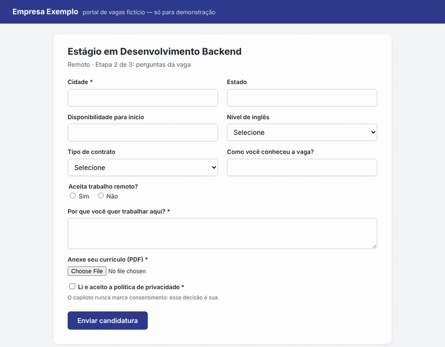
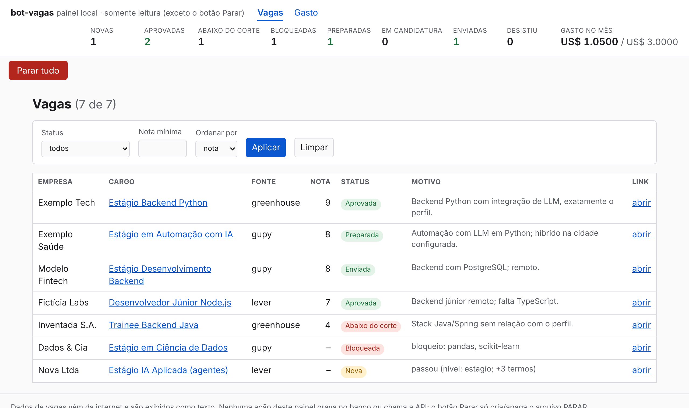
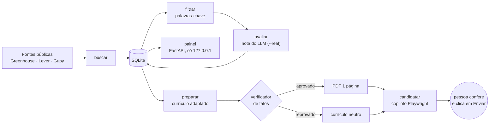

# bot-vagas

[](https://github.com/Thiago-Mateus0/bot-vagas/actions/workflows/testes.yml)

[](LICENSE)

Uma ferramenta que **encontra vagas de estágio, filtra por perfil, adapta o currículo com um LLM sem inventar
nada e preenche os formulários de candidatura**. Quem confere e clica em "Enviar" é sempre uma pessoa.

Construí este projeto para resolver um problema meu: procurar estágio toma horas por semana, e quase todo esse
tempo vai para tarefas repetitivas (ler vaga que não serve, digitar a mesma cidade em todo formulário).



*O copiloto num formulário de demonstração (portal fictício). Em verde, o que o bot preencheu; em laranja, o que
ele deixa para a pessoa: pergunta aberta e consentimento. Ele nunca clica em nada.*

## O que ele faz

1. **Busca** vagas em fontes públicas (APIs do Greenhouse e do Lever, página de busca da Gupy).
2. **Filtra** por palavras-chave (nível, local, área) e, opcionalmente, pede uma **nota de 0 a 10** a um LLM
   (Claude Haiku), com teto de gasto mensal.
3. **Adapta o currículo** para a vaga (PT ou EN, sempre 1 página). Um **verificador de fatos** rejeita qualquer
   habilidade, empresa ou resultado que não esteja no perfil original.
4. **Copiloto de formulário:** abre a vaga num navegador visível, preenche os campos que reconhece, anexa o PDF e
   destaca o resto.
5. **LinkedIn (opcional, automático):** `aplicar-linkedin` envia a Candidatura Simplificada das vagas que passam no
   filtro, com limite diário e desistindo de qualquer pergunta sem resposta segura. Os termos do LinkedIn proíbem
   automação (risco para a conta); veja [docs/USO.md](docs/USO.md) e comece com `--sem-enviar`.
6. **Painel local** com as vagas, os status, o histórico e o gasto com a API.



## Arquitetura



A rodada diária (`buscar` + `filtrar`) roda sozinha às 14h por um timer do systemd. A candidatura é sempre
acompanhada por uma pessoa.

## Decisões de engenharia

Resumo das escolhas; o raciocínio completo está em [docs/DECISOES.md](docs/DECISOES.md).

- **Semi-automático de propósito.** Comecei planejando candidatura 100% automática e mudei de ideia: um envio errado
  não tem volta, formulários exigem julgamento, e automação total levaria a contornar captcha e termos de uso.
  O copiloto não clica, não marca consentimento e não toca em login. Testes verificam que nenhum evento de clique
  ou submit é disparado.
- **LLM sem alucinação no currículo.** O modelo só reorganiza fatos de um YAML estruturado. O verificador de fatos
  compara cada termo gerado com o perfil e, se algo não existir lá, descarta a versão adaptada.
- **Custo sob controle.** Nenhuma chamada paga acontece sem a flag `--real`. Há um contador próprio com teto de
  US$ 3/mês, e o prompt fixo usa cache e esforço baixo.
- **Privacidade.** Dados pessoais ficam só em arquivos locais fora do git e nunca vão para o modelo nem para os logs
  (há testes de não vazamento).
- **Segurança do painel.** Escuta só em loopback, valida o Host (DNS rebinding), escapa todo texto externo (XSS),
  exige Origin local nos POSTs (CSRF) e usa CSP restritiva.
- **Robustez.** Botão PARAR que interrompe qualquer execução; encerramento limpo com janela fechada, Ctrl+C ou
  SIGTERM; detecção de mudança de formato nas fontes (o bot para e avisa, não contorna).

### Um bug que vale contar

No primeiro uso real, fechar a janela do navegador não encerrava o copiloto, e o Ctrl+C travava o programa. Eram
duas causas:

1. A espera usava `time.sleep`. Na API síncrona do Playwright, os eventos (como "a janela fechou") só são processados
   durante uma chamada ao Playwright, então o fechamento nunca era percebido.
2. O `KeyboardInterrupt` do Ctrl+C era levantado dentro do greenlet do Playwright e quebrava o laço interno dele.
   Qualquer chamada seguinte, como `ctx.close()`, girava para sempre.

A correção espera com `wait_for_event("close")`, transforma os sinais em uma flag conferida a cada ciclo e fecha o
navegador com prazo máximo. O teste de regressão manda um sinal real para o **grupo de processos**, como o
terminal faz, e confere que o resumo é gravado.

## Stack

Python 3.12 · Playwright · SQLite · FastAPI + Jinja2 (sem JavaScript) · SDK da Anthropic + pydantic · pypdf ·
pytest · systemd timer · ntfy.sh

## Testes

```bash
.venv/bin/pytest -q     # 280 testes, sem rede e sem API paga
```

Os testes rodam o navegador de verdade (headless) contra páginas de teste locais, usam clientes falsos no lugar
da API do LLM e incluem testes de segurança (XSS, SSRF, CSRF) e de não vazamento de dados pessoais. O CI roda tudo
a cada push.

## Rodando

```bash
python3.12 -m venv .venv && .venv/bin/pip install -e '.[dev]'
.venv/bin/playwright install chromium
cp perfil.example.yaml perfil.yaml && cp respostas.example.yaml respostas.yaml

.venv/bin/python demo/criar_demo.py --vitrine                 # dados fictícios para explorar o painel
.venv/bin/bot-vagas painel --banco demo/vagas-demo.db         # http://127.0.0.1:8765
```

O manual completo (comandos, copiloto, agendamento, notificações) está em [docs/USO.md](docs/USO.md). As imagens
deste README são geradas por `demo/gerar_imagens.py`.

## Como foi construído

Desenvolvi o projeto usando agentes de código (Claude Code) como par de programação: eu defini o problema, os
requisitos e as regras (o que o bot pode e não pode fazer), revisei as entregas e testei no uso real. As notas de
trabalho entre sessões estão em [docs/desenvolvimento/](docs/desenvolvimento/).

---

Licença: [MIT](LICENSE).

**In English:** a personal job-application assistant for internships. It fetches postings from public job boards,
filters them with keyword rules and an optional LLM score (with a hard monthly budget), tailors a one-page résumé
with a fact checker that rejects anything not in the source profile, and fills application forms in a visible
browser **without ever clicking submit**. Built with Python, Playwright, SQLite, FastAPI and the Anthropic SDK;
280 offline tests, including security and data-leak checks.
